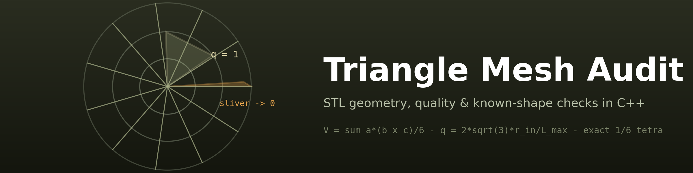
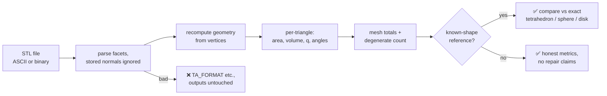
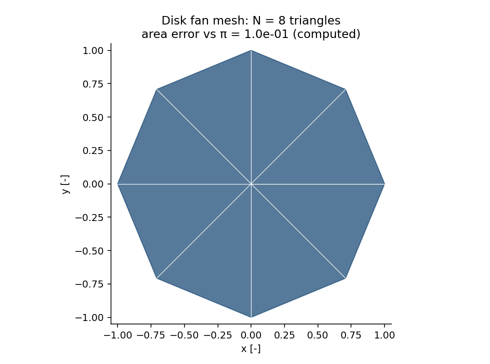

<div align="center">



# 🔺 Triangle Mesh Audit

### STL geometry, quality & known-shape checks

**An original C++ triangle-mesh inspector — ASCII/binary STL parsing with normals
recomputed from vertices, exact area/volume/quality metrics, and honest orientation
semantics — recovering the unit tetrahedron's exact volume 1/6 and the sphere's
4π/3 to 1.8e-3 at 9,024 triangles.**

[](https://github.com/khalil-official/triangle-mesh-audit/actions/workflows/ci.yml)
[](LICENSE)
[](src)
[](docs/verification.md)
[](https://github.com/khalil-official/triangle-mesh-audit/stargazers)
[](https://github.com/khalil-official/triangle-mesh-audit/commits)

[Quick start](#-quick-start) · [Metrics](#-metrics-and-semantics) · [Animation](#%EF%B8%8F-results-gallery) · [Results](#-results-and-metrics) · [References](#-references)

</div>

---

## 🎯 Purpose and scope

A scoped STL/triangle geometry inspector: **parse, measure, and check**.

> Supports ASCII and binary STL (stored normals ignored — geometry is recomputed).
> **Out of scope:** manifold repair, vertex welding, n-gons, normals output.

| | |
| --- | --- |
| 📥 **Parsing** | ASCII + binary STL, error codes TA_OK/NULL/IO/FORMAT/EMPTY/NONFINITE; failures never partially populate outputs |
| 📐 **Per triangle** | area, signed volume contribution a·(b×c)/6, shape quality q = 2√3·r_in/L_max (equilateral = 1, slivers → 0), min/max angle |
| 🧮 **Per mesh** | counts (degenerates counted, never dropped), total area, signed volume |
| 🧭 **Orientation** | honest star-shape semantics — validated against a known enclosed volume |

## 🧮 Metrics and semantics

- Per triangle: area, signed volume contribution a·(b×c)/6, shape quality
  q = 2√3·r_in/L_max (equilateral = 1, slivers → 0), min/max angle.
- Mesh: counts (degenerates counted, never dropped), total area, signed volume
  (+V for consistent outward winding of a closed surface).
- **Honest orientation semantics**: the star-shape ratio |Σsigned|/Σ|contrib| is 1
  only for origin-enclosing star-shaped meshes — a translated correctly-wound mesh
  legitimately mixes per-face signs (the tests prove it). Orientation is validated
  against a known enclosed volume.
- Error codes TA_OK/NULL/IO/FORMAT/EMPTY/NONFINITE; parse failures never partially
  populate outputs.

Details: [docs/model.md](docs/model.md); API: [docs/api.md](docs/api.md).

### STL file to audited mesh



## ⚡ Quick start

```bash
cmake -S . -B build
cmake --build build --config Release --parallel
ctest --test-dir build -C Release --output-on-failure   # CI gate
python examples/run_verification.py                     # figures + GIF
```

Verified with GCC 16.2.0 (WinLibs) locally; CI on Ubuntu + Windows.

<details>
<summary><b>🧱 Architecture & API example</b></summary>

```
src/stl_audit.{hpp,cpp}   # parsing + geometry/quality (whole library)
src/stl_demo.cpp          # sphere/disk generator + CSV writer
tests/test_stl_audit.cpp  # CTest gate
examples/run_verification.py
docs/ model.md  api.md  verification.md  results/
```

```cpp
triangle_mesh::ta_stats st;
if (triangle_mesh::audit_file("mesh.stl", &st) == triangle_mesh::TA_OK)
    std::printf("area=%.6f volume=%.6f\n", st.total_area, st.signed_volume);
```

</details>

## ✅ Verification

Seven test groups (see [docs/verification.md](docs/verification.md)): exact
primitive geometry, translation invariance with honest star-ratio semantics,
flipped-face detection, ASCII/binary round trip with bogus-normal injection,
invalid-input rejection, degenerate counting.

## ⚠️ Limitations

- Inspection tool: no repair, welding, or manifold validation.
- Binary STL precision is float32 by format.
- Volume/area accuracy for generated meshes is polygonal-resolution limited
  (honest per-case values below).

---

## 🎞️ Results gallery

<div align="center">

**▶ Watch the mesh refine:**



<sub>41 frames — each a computed disk fan triangulation at growing resolution with
its measured area error against π (the same convention the audit reports).
Produced by <code>examples/run_verification.py</code>.</sub>

</div>

### 📈 Results and metrics

| Case | Metric | Value |
| --- | --- | --- |
| Unit tetrahedron (exact) | area / signed volume | 3/2+√3/2 and **1/6 exact** |
| Equilateral triangle | q / angles | **1** / 60° exact |
| Binary STL with bogus stored normals | audit unchanged | geometry from vertices |
| Unit sphere 48×96 (9,024 tris) | volume vs 4π/3 | **1.78e-3** (mesh resolution) |
| Disk fan refinement N=8…1024 | area error vs π | follows O(h²) reference |
| Flipped-face mesh | signed volume deviation | ≥ 0.5 from truth (detected) |

### 🖼️ Static figures & raw data

Raw data: [docs/results/](docs/results) — `disk_refinement.csv`,
`sphere_audit.png`, `run_summary.json`, animation `mesh_refinement.gif`.

## 📚 References

- STL format specification (binary 84+50n layout; ASCII facet syntax).
- J. Shewchuk, "Lecture Notes on Geometric Robustness" (area/volume conventions
  context).
- C. B. Barber et al., "The Quickhull algorithm for convex hulls" (mesh geometry
  context).

This repository's own code is original and MIT-licensed; see [LICENSE](LICENSE).
